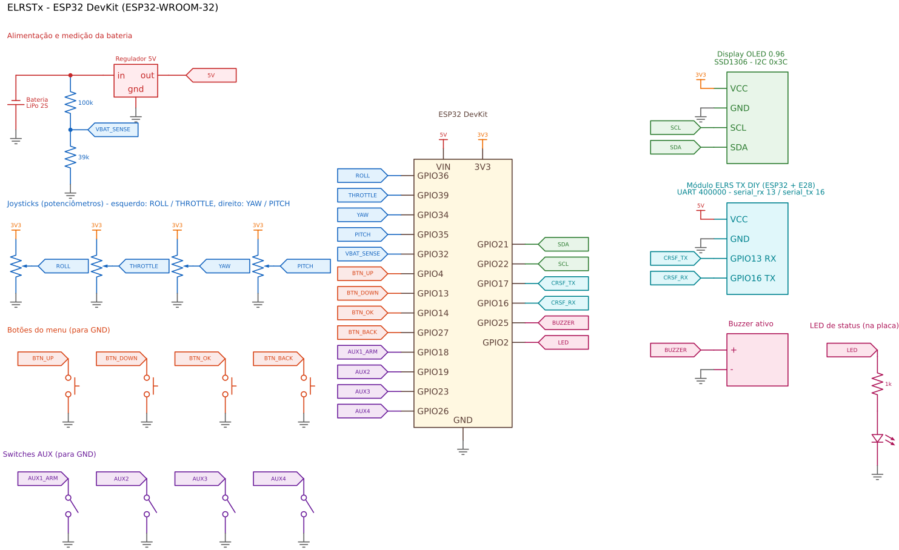

# ELRSTx — Rádio controle ESP32 para módulo ExpressLRS

Rádio com dois joysticks analógicos, quatro switches e um OLED, que controla um módulo **ExpressLRS TX** via CRSF.

## Recursos

- 4 eixos analógicos (AETR) + 4 switches AUX (CH5–CH8, AUX1 = arm)
- CRSF a 400000 baud com **telemetria bidirecional**: link (RSSI/LQ/SNR/potência), bateria do modelo, atitude, GPS, modo de voo e nome do módulo
- **Sincronização com o módulo**: envia na mesma taxa de pacotes do ELRS (ex.: 250 Hz), ou 50 Hz sem sync
- Calibração por eixo, deadband, inversão e mapeamento de canais
- **5 perfis de modelo** salvos na flash (NVS, com checksum)
- **Segurança**: safe start (acelerador e arm bloqueados no boot até acelerador baixo + arm desligado), alarme de perda de link e de bateria baixa (LED + buzzer)
- **Bateria do rádio** por divisor resistivo, com porcentagem para LiPo
- **Display OLED 128x64** com menu: canais, telemetria, calibração, ajustes, perfis, WiFi/OTA e info
- **Configuração do módulo ExpressLRS** pelo rádio, como o script Lua do EdgeTX: taxa de pacotes, telemetria, potência, Bind, WiFi do módulo, Model Match e demais opções, lidas do próprio módulo
- **WiFi AP** com página web de status, comandos e **atualização OTA**; também OTA pelo PlatformIO

> **Failsafe:** quando o link cai, o rádio não consegue mais falar com o modelo. O comportamento do aeromodelo na perda de sinal é configurado no receptor/controladora de voo (ex.: Betaflight → Failsafe). O rádio cuida do safe start e dos alarmes.

## Placas suportadas

| Placa | Ambiente | Botões/switches |
|-------|----------|-----------------|
| **ESP32 DevKit (ESP32-WROOM-32)** — padrão | `esp32dev` | direto nos GPIOs |
| ESP32-C3 | `esp32-c3-devkitm-1` | expansor I2C PCF8574 |

Pinagem completa das duas, comparação e a opção ESP32-S3: **[docs/HARDWARE.md](docs/HARDWARE.md)**.



## Hardware (DevKit)

- ESP32 DevKit (ESP32-WROOM-32)
- Módulo ExpressLRS TX com **UART de 2 pinos** (TX/RX separados)
- 2 joysticks analógicos 3.3 V
- 4 botões de menu + 4 switches (entre o pino e o GND)
- OLED 0.96" SSD1306 128x64 I2C de 4 pinos (0x3C) — opcional
- Divisor 100k/39k para a bateria (até ~11.7 V) — opcional
- Buzzer ativo — opcional

| GPIO | Função |
|------|--------|
| 36 / 39 | Joystick esquerdo X (Roll) / Y (Throttle) |
| 34 / 35 | Joystick direito X (Yaw) / Y (Pitch) |
| 32 | Bateria |
| 21 / 22 | I2C SDA / SCL (OLED) |
| 16 / 17 | CRSF RX ← TX do módulo / CRSF TX → RX do módulo |
| 2 | LED da placa |
| 25 | Buzzer |
| 4 / 13 / 14 / 27 | Botões cima / baixo / OK / voltar |
| 18 / 19 / 23 / 26 | AUX1 (arm) / AUX2 / AUX3 / AUX4 |

O módulo detecta o baud automaticamente entre `400000, 115200, 921600, 1870000, ...`. **420000 não funciona** — essa é a velocidade entre receptor e controladora de voo.

## Compilar e gravar

```bash
pio run -t upload                         # ESP32 DevKit
pio run -e esp32-c3-devkitm-1 -t upload   # ESP32-C3
pio device monitor                        # 115200 baud
```

No primeiro boot, os testes unitários rodam e o resultado aparece no monitor. Desative `RUN_UNIT_TESTS` em [src/main.cpp](src/main.cpp) depois de conferir.

## Primeiros passos

1. Grave o firmware e abra o monitor. A linha de status mostra `module ok` quando o módulo responde.
2. Digite `status`. Se aparecer `NOT RESPONDING`, confira os fios RX/TX (cruzados), o GND e se o módulo está ligado.
3. Calibre: `cal center` (sticks no centro), `cal start`, mova todos os sticks até o limite, `cal stop`. Ou use o menu **Calibrate**.
4. Ligue o receptor: `status` deve mostrar LQ e RSSI.
5. Abaixe o acelerador e desligue o AUX1 para liberar o safe start.

## Display

Tela inicial (botão OK abre o menu):

```
Model 1            7.6V   <- perfil e bateria do rádio
ELRS 2.4G TX              <- nome do módulo (ou "No ELRS module")
LQ 100%  -45dBm           <- link com o receptor
250Hz  15.8V              <- taxa de envio e bateria do modelo
[ THR DOWN + DISARM ]     <- alarme ativo, ou modo de voo
[R===][P== ][T=  ][Y===]  <- posição dos 4 sticks
   ■     □     □     □    <- AUX1..AUX4
```

Menu: **ExpressLRS** (parâmetros do módulo TX: OK entra na pasta ou edita, cima/baixo muda o valor, OK grava, voltar cancela; comandos como Bind abrem uma janela de confirmação), **Channels** (barras e µs de CH1–8), **Telemetry** (RSSI/LQ/SNR, bateria, atitude, GPS, modo de voo), **Calibrate** (assistente em 2 passos), **Settings** (deadband, inversões, safe start, alarme de link, células e limites da bateria, simulação; grava ao sair), **Profiles** (5 modelos), **WiFi / OTA** (liga/desliga e mostra rede, senha e endereço) e **Info** (versão, frames, telemetria ok/ruim, memória, tempo ligado).

## Comandos (Serial e web)

```
status                  módulo, link, bateria, taxa
config                  configurações em JSON
set <chave> <valor>     altera (na RAM); depois 'save'
save                    grava na flash
profile [0-4]           lista ou seleciona perfil
defaults                volta aos padrões (não grava)
cal [center|start|stop|cancel]
sim [on|off]            simulação dos sticks (t alterna)
frame                   último frame CRSF (f)
wifi on|off             AP + página web + OTA
mon on|off              linha de status a cada segundo
elrs                    parâmetros do módulo ExpressLRS
elrs set <id> <valor>   altera um parâmetro (texto da opção ou índice)
elrs cmd <id> [confirm|cancel]  executa um comando (Bind, WiFi...)
elrs reload             relê os parâmetros
reboot
```

Chaves: `name`, `deadband`, `invert.<eixo>`, `map.<eixo>` (canal 1–4), `safestart`, `linkalarm`, `linktimeout`, `batt.ratio` ((R1+R2)/R2 × 1000), `batt.cells`, `batt.warn`, `batt.crit` (mV por célula), `cal.<eixo>` (`min,centro,max`), `wifipass`. Eixos: `roll pitch throttle yaw`.

## Configuração remota e OTA

- **WiFi:** `wifi on` (ou menu WiFi / OTA). Conecte na rede `ELRSTx-XXXX` (senha padrão `elrstx1234`) e abra `http://192.168.4.1`. A página mostra o status, aceita comandos e faz upload do `firmware.bin`.
- **OTA pelo PlatformIO:** com o AP ligado e o PC conectado nele, rode `pio run -e ota -t upload`.

Deixe o WiFi desligado durante o voo: ele usa 2.4 GHz, a mesma faixa dos módulos ELRS de 2.4 GHz.

## LED de status

| Padrão | Significado |
|--------|-------------|
| Aceso fixo | Link com o receptor |
| Pisca lento (1 Hz) | Sem receptor |
| Duas piscadas curtas por segundo | Aviso (sem módulo, safe start, bateria baixa) |
| Pisca rápido (4 Hz) | Perda de link ou bateria crítica |
| Aceso com uma falha curta por segundo | WiFi ligado |

Se o LED aparecer invertido, troque `LED_ACTIVE_LOW` em [include/Pins.h](include/Pins.h). Com `LED_IS_RGB 1`, um WS2812 mostra cores (verde = link, azul = sem receptor, amarelo = aviso, vermelho = alarme, roxo = WiFi).

## Estrutura

```
include/Pins.h        pinagem por placa e parâmetros de hardware
src/main.cpp          task de RC (timer) + loop da interface
src/CRSF.cpp          protocolo: frames RC, ping, parser de telemetria
src/Config.cpp        configurações e perfis na NVS
src/Inputs.cpp        joysticks, simulação, bateria
src/Safety.cpp        safe start e calibração
src/State.cpp         estado compartilhado entre as tasks
src/UI.cpp            OLED, menu, botões/switches, LED, buzzer, alarmes
src/ElrsParams.cpp    parâmetros do ExpressLRS (protocolo do Lua)
src/Commands.cpp      comandos de texto
src/Remote.cpp        WiFi AP, web, OTA
src/CRSFTest.cpp      testes do protocolo
docs/HARDWARE.md      placas, pinagens e ligações
docs/SIMULATION.md    modo de simulação
```
