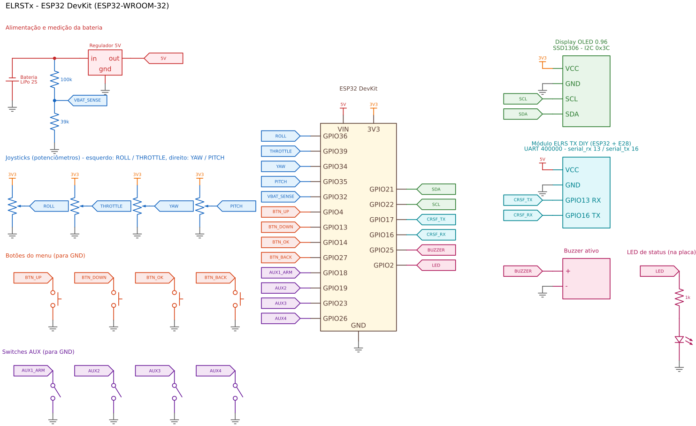
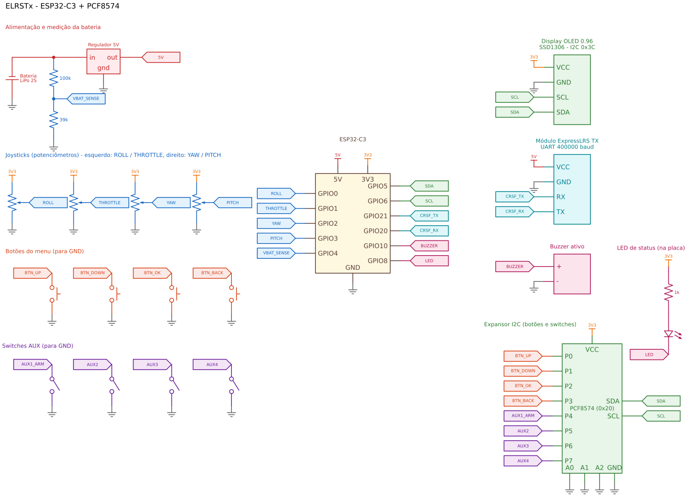
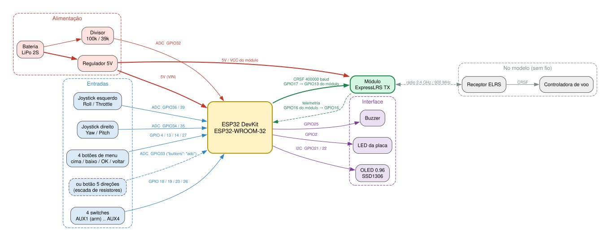
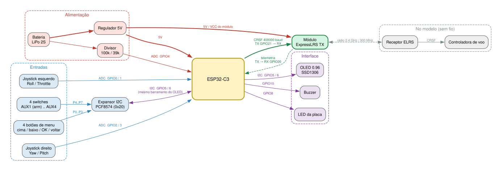
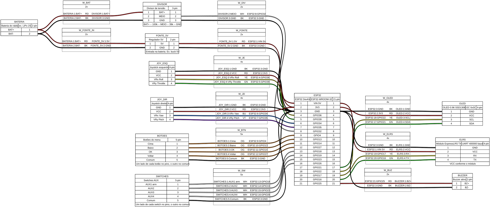
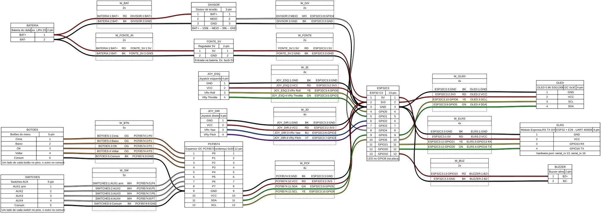
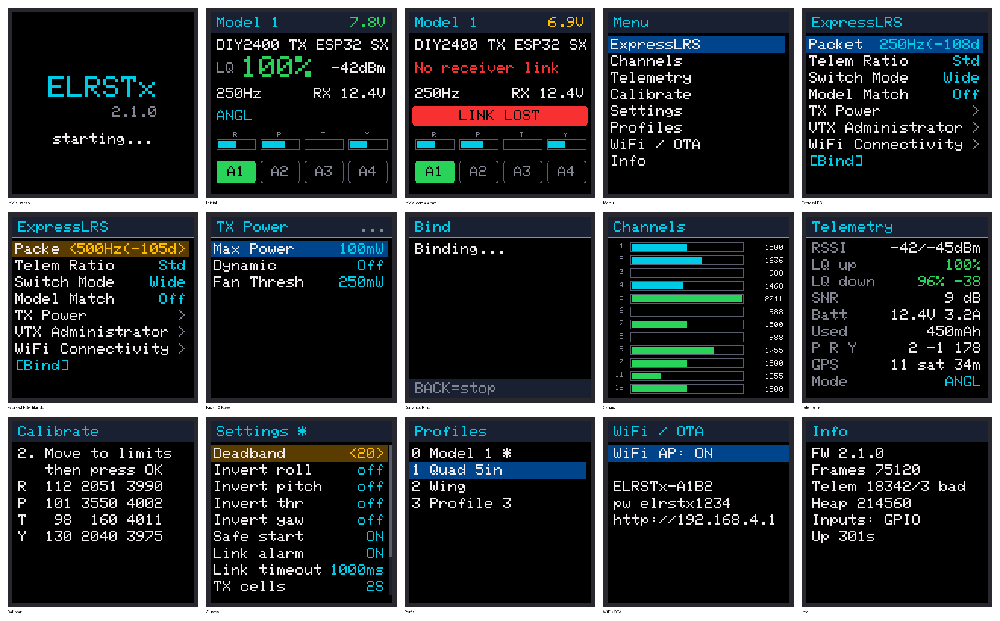

# Opções de placa e pinagem

O firmware compila para dois chips. A pinagem não fica no código: vem de um `hardware.json`, como no ExpressLRS. O padrão de cada placa ([hardware/esp32dev.json](../hardware/esp32dev.json), [hardware/esp32c3.json](../hardware/esp32c3.json)) vai embutido no firmware, e pode ser trocado sem recompilar com `hw set` pelo serial ou em `http://192.168.4.1/hardware`. As tabelas abaixo mostram os valores padrão. Detalhes no [README](../README.md#pinagem-e-hardwarejson).

| | ESP32 DevKit (padrão) | ESP32-C3 (alternativa) | ESP32-S3 (não implementado) |
|---|---|---|---|
| Ambiente | `esp32dev` | `esp32-c3-devkitm-1` | — |
| GPIOs livres | ~25 | ~15 | ~35 |
| Botões e switches | direto nos GPIOs | PCF8574 por I2C | direto nos GPIOs |
| ADC | menos linear (a calibração compensa) | bom | bom |
| USB | chip USB-serial | USB nativo | USB nativo |
| Flash usada | ~1,1 MB de 1,9 MB | ~1,2 MB de 1,9 MB | — |

Gravar:

```bash
pio run -e esp32dev -t upload              # DevKit (padrão, basta 'pio run -t upload')
pio run -e esp32-c3-devkitm-1 -t upload    # C3
```

## Esquemático

### ESP32 DevKit (padrão)



### ESP32-C3 + PCF8574



As ligações são feitas por **rótulos de rede**: pinos com o mesmo nome (ex.: `SDA`, `CRSF_TX`) estão ligados entre si. `3V3` e `5V` são as linhas de alimentação. O LED de status já vem na placa.

## Diagrama de blocos

### ESP32 DevKit (padrão)



### ESP32-C3 + PCF8574



Cores: vermelho = alimentação, azul = entradas, roxo = interface com o usuário, verde = link CRSF com o módulo, cinza tracejado = rádio até o modelo. O fio a fio de cada placa está nos diagramas de ligações mais abaixo.

## ESP32 DevKit (ESP32-WROOM-32) — padrão

| GPIO | Função |
|------|--------|
| 36 (VP) | Joystick esquerdo X → Roll (CH1) |
| 39 (VN) | Joystick esquerdo Y → Throttle (CH3) |
| 34 | Joystick direito X → Yaw (CH4) |
| 35 | Joystick direito Y → Pitch (CH2) |
| 32 | Bateria (meio do divisor) |
| 21 / 22 | I2C SDA / SCL (OLED) |
| 17 | CRSF, um fio (padrão) / TX → RX do módulo com dois fios |
| 16 | CRSF RX ← TX do módulo (só com dois fios) |
| 2 | LED azul da placa |
| 25 | Buzzer |
| 4 / 13 / 14 / 27 | Botões cima / baixo / OK / voltar |
| 18 / 19 / 23 / 26 | Switches AUX1 (arm) / AUX2 / AUX3 / AUX4 |
| 33 | livre |

Regras seguidas nessa pinagem:
- **Analógicos só no ADC1 (GPIO 32–39).** O ADC2 para de funcionar com o WiFi ligado.
- **GPIO 34–39 são só entrada e não têm pull-up**: servem para analógicos, não para botões.
- **Pinos de boot (0, 2, 5, 12, 15) fora dos botões.** O GPIO12 puxado para cima, por exemplo, impede o boot.
- Botões e switches vão **entre o pino e o GND**, usando o pull-up interno.

### Diagrama de ligações (DevKit)



Fonte: [wiring/esp32dev.yml](wiring/esp32dev.yml). Inclui alimentação, divisor da bateria e todos os GND.

## ESP32-C3 com PCF8574 — alternativa

O C3 não tem pinos suficientes para 8 botões/switches, então eles entram por um expansor I2C **PCF8574** (endereço 0x20; o PCF8574A usa 0x38), no mesmo barramento do OLED.

| GPIO | Função |
|------|--------|
| 0 / 1 / 2 / 3 | Roll / Throttle / Yaw / Pitch |
| 4 | Bateria |
| 5 / 6 | I2C SDA / SCL (OLED + PCF8574) |
| 21 | CRSF, um fio (padrão); com dois fios: 20 RX / 21 TX |
| 8 | LED (comum, aceso em LOW, como na SuperMini; WS2812 com `"led_rgb": true`) |
| 10 | Buzzer |

| PCF8574 | Função |
|---------|--------|
| P0 / P1 / P2 / P3 | Cima / baixo / OK / voltar |
| P4 / P5 / P6 / P7 | AUX1 (arm) / AUX2 / AUX3 / AUX4 |

Use o módulo PCF8574 avulso. O que vem soldado atrás de LCD 16x2 já tem os pinos ligados ao LCD.

### Diagrama de ligações (C3)



Fonte: [wiring/esp32c3.yml](wiring/esp32c3.yml). OLED e PCF8574 dividem os mesmos fios SDA/SCL.

## ESP32-S3 — opção futura

Tem mais pinos, ADC melhor, USB nativo. Ainda não há pinagem nem ambiente para ele; precisaria de um `hardware/esp32s3.json` e um ambiente no `platformio.ini`.

## Módulo ExpressLRS TX DIY (ESP32 + E28)

O módulo de rádio é um segundo ESP32 DevKit com um EBYTE E28 (SX1280, 2.4 GHz), gravado com o ExpressLRS **3.5.3** pelo Configurator, alvo **"DIY 2400 TX ESP32 SX1280 E28"**. O receptor precisa estar na mesma versão principal (3.x) e com a mesma binding phrase.

| Função no módulo | GPIO do módulo |
|---|---|
| CRSF RX (vem do ELRSTx) | **13** |
| CRSF TX (vai para o ELRSTx) | **16** |
| SX1280 SCK / MISO / MOSI | 18 / 19 / 23 |
| NSS / RESET / BUSY / DIO1 | 5 / 14 / 15 / 4 |
| E28 TXEN / RXEN / LNA | 26 / 27 / 12 |
| OLED do módulo SDA / SCL (opcional) | 21 / 22 |
| Joystick do menu / ventoinha | 35 / 17 |

Há duas formas de ligar o ELRSTx ao módulo. **Os dois lados precisam usar a mesma**: o `hardware.json` do ELRSTx (`crsf_rx`/`crsf_tx`) e o do módulo (`serial_rx`/`serial_tx`, em `http://<ip-do-módulo>/hardware.html`).

| | Um fio (como a baia JR de um rádio) | Dois fios |
|---|---|---|
| Fios | **GPIO17 → GPIO13 do módulo**, GND | **GPIO17 → GPIO13 do módulo**, **GPIO16 do módulo → GPIO16**, GND |
| ELRSTx | `crsf_rx = 17`, `crsf_tx = 17` | `crsf_rx = 16`, `crsf_tx = 17` |
| Módulo | `serial_rx = 13`, `serial_tx = 13` (padrão do alvo) | `serial_rx = 13`, `serial_tx = 16` |
| Sinal | half-duplex, invertido | full-duplex, sem inversão |

No C3 o ELRSTx usa GPIO21 (um fio) ou 20 RX / 21 TX (dois fios).

Com um fio, o ELRSTx envia o frame de canais e solta a linha para o módulo responder com a telemetria, como o EdgeTX faz. Um resistor de ~1 kΩ em série no fio protege os dois lados se um erro de tempo fizer os dois transmitirem juntos.

Em qualquer caso, o módulo deve ficar **sem `led_rgb`**: o layout personalizado vinha com `led_rgb = 15`, o mesmo pino do BUSY do SX1280, o que atrapalha o rádio. Depois de regravar pelo Configurator, confira de novo esses campos.

O módulo **só transmite quando recebe CRSF de um rádio**. Sem o ELRSTx ligado, ele entra no WiFi depois de `wifi-on-interval` segundos e o receptor nunca conecta. Os parâmetros do módulo (taxa, potência, telemetria, Bind) podem ser alterados pelo próprio ELRSTx: menu **ExpressLRS** ou comando `elrs`.

## Alimentação e bateria

Os diagramas acima já mostram a alimentação. O regulador 5V é um exemplo: use o que fornecer a tensão que o seu módulo ELRS pede. O divisor é 100k (BAT+ → meio) e 39k (meio → GND), com o meio no GPIO32 (DevKit) ou GPIO4 (C3).


**Todos os GND ficam ligados juntos**: bateria, regulador, ESP32, módulo ELRS, joysticks, OLED, buzzer e o lado comum dos botões e switches. Joysticks, OLED e PCF8574 vão no **3V3**, nunca no 5V.

## Comum a todas as placas

**Display:** escolhido no `hardware.json` (`display`), sem recompilar. Os dois drivers vão no firmware.

| Display | `hardware.json` | Ligação (padrão do DevKit) |
|---------|-----------------|---------|
| OLED 0.96" SSD1306 128x64, I2C de 4 pinos (padrão) | `"display": "ssd1306"` | SDA/SCL do I2C, VCC 3V3, endereço `oled_addr` 60 = 0x3C (alguns usam 61 = 0x3D) |
| IPS 1.3"/1.54" ST7789 240x240, SPI | `"display": "st7789"` | SCL → GPIO22, SDA → GPIO21, DC → GPIO33, RES → GPIO5, BLK → 3V3, VCC 3V3 |
| nenhum | `"display": "none"` | |

```
hw set display st7789
reboot
```

Cada display tem seu próprio driver com layout e cores próprios (camada em [include/Display.h](../include/Display.h): `DisplaySSD1306.cpp`, `DisplayST7789.cpp`, `DisplayNone.cpp`). O `UI.cpp` só decide o que mostrar. No ST7789 a tela é colorida e ocupa os 240x240: LQ grande em verde/amarelo/vermelho, alarmes em faixa colorida, listas de 9 linhas com barra de rolagem e 12 canais. Prévia das telas: [screens/all-st7789.png](screens/all-st7789.png) e [screens/all-ssd1306.png](screens/all-ssd1306.png), geradas por `python docs/screens/render_screens.py`.



O ST7789 usa os pinos do I2C do OLED, então os dois não funcionam ao mesmo tempo. Módulos com pino CS: ligue o CS ao GND. Para girar a imagem: `hw set tft_rotation 1` (0 a 3). No ESP32-C3 sobram poucos pinos para o SPI. OLEDs de 1.3" com SH1106 não são suportados.

**Módulo ExpressLRS:** um fio (`crsf_rx` = `crsf_tx`, padrão) até o pino CRSF/S.Port do módulo, como a baia JR, ou dois fios (TX do ESP → RX do módulo, RX do ESP ← TX do módulo). GND comum. Baud **400000** (o módulo não aceita 420000). Veja a tabela na seção do módulo DIY.

**Bateria:** divisor 100k (do + da bateria) / 39k (para GND), com o meio no pino de bateria. Mede até ~11,7 V. Para outro divisor: `set batt.ratio <(R1+R2)/R2 × 1000>`.

**LED:** com `"led_rgb": true`, um WS2812/WS2812B no pino do LED mostra cores. Um único LED funciona sem mudar o código; vários LEDs precisariam de suporte a buffer de pixels.

**Joysticks:** use módulos alimentados com 3.3V. 5V nos pinos analógicos danifica o ESP32.

## Editar os diagramas

Esquemáticos: script Python com [schemdraw](https://schemdraw.readthedocs.io), um bloco por placa em `BOARDS`.

```bash
pip install schemdraw matplotlib
python docs/wiring/schematic.py
```

Diagramas de blocos: arquivos Graphviz `docs/wiring/blocks-*.dot`.

```bash
dot -Tsvg docs/wiring/blocks-esp32dev.dot -o docs/wiring/blocks-esp32dev.svg
dot -Tsvg docs/wiring/blocks-esp32c3.dot  -o docs/wiring/blocks-esp32c3.svg
```

Diagramas de ligações (fio a fio): são gerados pelo [WireViz](https://github.com/wireviz/WireViz) a partir dos arquivos YAML em `docs/wiring/`. Depois de alterar um YAML:

```bash
pip install wireviz          # precisa do Graphviz instalado (winget install Graphviz.Graphviz)
wireviz -f ps docs/wiring/esp32dev.yml
wireviz -f ps docs/wiring/esp32c3.yml
```

`-f ps` gera só o PNG e o SVG. Mantenha os YAML em sincronia com [hardware/esp32dev.json](../hardware/esp32dev.json) e [hardware/esp32c3.json](../hardware/esp32c3.json). Os diagramas mostram a ligação de dois fios.
